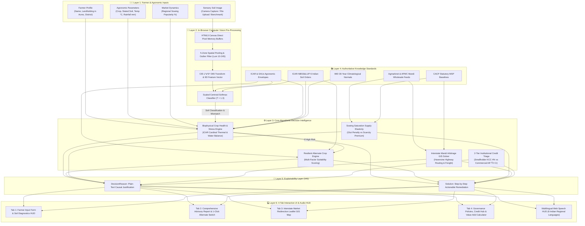
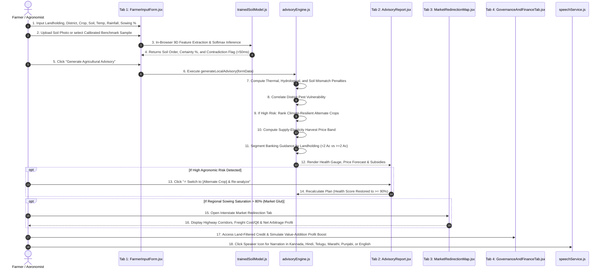

<div align="center">

# 🌱 AgriCopilot (agriAi)
### Precision Agronomy, In-Browser Pedological Vision, Mandi Arbitrage & Institutional Credit

[](https://reactjs.org/)
[](https://vitejs.dev/)
[](https://tailwindcss.com/)
[](https://leafletjs.com/)
[](https://developer.mozilla.org/en-US/docs/Web/API/Web_Speech_API)
[](https://github.com/YuvanChaudary/Agri-Copilot)
[](https://opensource.org/licenses/MIT)

<p align="center">
  <b>An offline-first, client-side agricultural decision intelligence platform and precision agronomy copilot designed to empower Indian smallholders and commercial cultivators.</b>
</p>

[Problem Statement](#-problem-statement) • [The Solution](#-the-solution) • [Key Features](#-key-features) • [System Architecture](#-system-architecture) • [User Flow](#-user-flow) • [Mathematical Formulations](#-core-mathematical-engines) • [Technology Stack](#-technology-stack) • [Installation & Setup](#-installation--quick-start) • [Verification Scenarios](#-verification-scenarios)

---

</div>

## 📌 Problem Statement

Indian agriculture sustains more than 50% of the nation's workforce and comprises over 85% smallholder farmers (<2.0 acres). Despite advancements in digital technology, farmers face a compounding crisis across three structural breakdown points:

1. **Biophysical Soil-Crop-Climate Mismatches:**
   - Farmers frequently cultivate crops based on historical habit, local imitation, or speculative price trends, rather than pedological compatibility.
   - Farm-gate soil testing is rarely accessible; physical laboratories take weeks to deliver reports. Planting crops in incompatible soils (e.g., water-thirsty Paddy in porous Alfisols) or during adverse thermal and moisture regimes causes severe yield loss (pollen sterility, flower abortion, and root asphyxiation).
2. **Post-Harvest Mandi Gluts & Distress Selling (The Cobweb Phenomenon):**
   - When a crop commands high prices in one season, a majority of regional farmers (>70%–80%) simultaneously plant that identical crop the next season.
   - At harvest, millions of quintals flood local APMC mandis simultaneously, triggering an acute **20% to 40% wholesale price collapse**. Farmers lack visibility into deficit terminal markets in neighboring states and cannot assess whether interstate freight would be profitable.
3. **Credit Asymmetry & Predatory Debt Traps:**
   - Smallholders (<2.0 acres) face documentation hurdles that exclude them from timely institutional credit, forcing them into the clutches of informal moneylenders charging **24% to 36% p.a.** interest.
   - Farmers remain unaware of subsidized 4% Kisan Credit Cards (KCC) or post-harvest storage loans (e-NWR) and sell raw produce without primary grading, forfeiting a **20% to 35% margin boost**.
4. **The "Black-Box" AI Dilemma & Digital Illiteracy:**
   - Existing apps operate in silos, act as unexplainable black boxes, and exclude illiterate farmers through complex, text-heavy English interfaces.

---

## 💡 The Solution: AgriCopilot

**AgriCopilot (agriAi)** is an offline-capable, zero-cloud-latency Single-Page Application (SPA) powered by **Explainable Artificial Intelligence (XAI)** and **Edge Computing**. It unites:
- **In-Browser Pedological Computer Vision:** 9D colorimetric feature extraction directly via HTML5 Canvas in **<50 ms**.
- **ICAR-Aligned Biophysical Crop Stress Engine:** Non-linear physiological thermal, moisture, and soil compatibility modeling.
- **Resilient Alternate Crop Recommendation Engine:** Dynamic multi-factor suitability scoring with a **1-Click Adaptive Switch**.
- **APMC Sowing Saturation & Supply Elasticity Forecasting:** Early warnings for harvest gluts (>80% saturation) and scarcity premiums (<35%).
- **Interstate Logistics Arbitrage Routing:** Interactive Leaflet GIS mapping computing road haulage distances (1.28 tortuosity) and net freight arbitrage margins to high-demand terminal hubs.
- **2-Tier Landholding-Segmented Institutional Credit Hub:** Automatic triage between subsidized 4% KCC micro-loans and ₹2 Crore AIF infrastructure loans.
- **Multilingual Voice Synthesis:** Web Speech API narration in **6 Indian languages** (Kannada, Hindi, Telugu, Marathi, Punjabi, English) with a measured 0.92 cadence for rural auditory clarity.

---

## 🌟 Key Features

| Capability | Technical Implementation | Farmer Benefit |
| :--- | :--- | :--- |
| **🔬 In-Browser Soil Vision** | 9D pedological vector ($L^*a^*b^*$, Hematite Redness Index, SOC Index, Laplacian Texture) + Softmax classifier via HTML5 Canvas. | Zero cloud API latency ($<50\text{ ms}$), 100% data privacy, and completely offline-capable. |
| **⚠️ Contradiction Detection** | Automated divergence check comparing user-selected soil against optical centroid prediction. | Prevents applying incorrect fertilizers or irrigation schedules with 1-click correction. |
| **🌡️ Biophysical Risk Modeling** | ICAR physiological thermal bounds ($T_{\text{min}}, T_{\text{max}}$) and rainfall water balance equations. | Detects acute heat stress (pollen sterility), cold shock, drought, and waterlogging root rot before disaster strikes. |
| **🛡️ Resilient Alternate Crop Engine** | Multi-factor suitability weighting: $\text{Suitability} = (S_{\text{soil}} \times 0.40) + (S_{\text{rain}} \times 0.35) + (S_{\text{temp}} \times 0.25)$. | Replaces high-risk crops with climate-resilient alternatives (e.g., Jowar or Ragi with 98% suitability) via **1-click adaptive switching**. |
| **📈 Harvest Price Elasticity** | Regional sowing popularity saturation model ($>80\%$ glut depression vs $<35\%$ scarcity surge). | Prevents selling at a loss during peak local harvest gluts; warns of wholesale price crashes in advance. |
| **🚚 Interstate Mandi Arbitrage Map** | Geospatial Leaflet routing calculating: $\text{Net Arbitrage} = (\text{Dest Price} - \text{Local Price}) - \text{Freight Cost/Qtl}$. | Connects farmers to deficit terminal markets (Mumbai Vashi, Pune, Chennai, Hyderabad) to unlock **+₹35,000 to +₹47,000** net gain per lot. |
| **🏛️ 2-Tier Institutional Banking** | Automatic landholding segmentation ($<2\text{ Acres}$ Smallholders vs $\ge 2\text{ Acres}$ Commercial Cultivators). | Directs marginal farmers to 4% KCC micro-credit & JLG loans; directs commercial farmers to AIF ₹2 Cr term loans & e-NWR pledge credit. |
| **💰 Value-Addition Simulator** | Interactive yield slider comparing raw distress auction revenue against on-farm sorting and grading. | Demonstrates a **+20% to +35%** net margin expansion through simple primary processing. |
| **🗣️ Multilingual Voice Accessibility** | Web Speech API integration in 6 regional languages (**Kannada, Hindi, Telugu, Marathi, Punjabi, English**). | Bridges the rural digital divide for farmers with limited literacy. |

---

## 🏛 System Architecture

The entire platform operates across a hierarchical **6-Layer Edge Computing Architecture** where all inference, agrometeorological rules, and geospatial routing execute directly on client hardware:



---

## 🔄 User Flow



---

## 🔬 Core Mathematical Engines

### 1. In-Browser Pedological Computer Vision Classifier
Executed directly via HTML5 Canvas memory buffers in `src/utils/soilImageAnalyzer.js` and `src/utils/trainedSoilModel.js`:
- **Adaptive 5-Zone Spatial Pooling:**
  $$\bar{C} = \left(\frac{C_{\text{center}}}{N_{\text{center}}} \times 0.65\right) + \left(\frac{C_{\text{outer}}}{N_{\text{outer}}} \times 0.35\right) \quad \forall C \in \{R, G, B\}$$
  *Luminance filtration ($\text{Lum} \in [10, 245]$) rejects fingers, shadows, and specular glare.*
- **Linearization & CIE-$L^*a^*b^*$ D65 Conversion:**
  Linearizes sRGB gamma, transforms into CIE XYZ under standard D65 illuminants, and converts to $L^*, a^*, b^*$.
- **9-Dimensional Pedological Feature Space:**
  1. $L^*$ (Perceptual Lightness: 0=pure black to 100=pure white)
  2. $a^*$ (Green-to-Red axis, hematite $\text{Fe}_2\text{O}_3$ ferric sesquioxides)
  3. $b^*$ (Blue-to-Yellow axis, quartz sand & silt content)
  4. Ferric Hematite Redness Index: $\text{RI} = \frac{R - G}{R + G + 0.001}$
  5. Soil Organic Carbon Index: $\text{SOC} = \frac{100 - L^*}{100}$
  6. Spatial Laplacian Texture Roughness: Gradient variance across micro-relief clods
  7. Normalized Chromaticity: $r_{\text{norm}}, g_{\text{norm}}, b_{\text{norm}}$ (Illuminant invariance)
- **Dimensionally Weighted Distance & Temperature-Scaled Softmax:**
  $$D_k = \sqrt{\sum_{i=1}^{9} w_i \cdot \left(\frac{f_i - \mu_{i,k}}{\sigma_{i,k}}\right)^2}$$
  $$P(\text{Class}_k) = \text{round}\left(\frac{\exp(-D_k / T)}{\sum_{j} \exp(-D_j / T)} \times 100\right), \quad T = 1.3$$

### 2. Agrometeorological Biophysical Stress Modeling
Implemented in `src/services/advisoryEngine.js`:
- **Thermal Penalties:** Heat stress ($T > T_{\text{max}}$) penalizes up to $-4.5$ points for pollen sterility; cold shock ($T < T_{\text{min}}$) penalizes up to $-4.2$ points for stunting.
- **Moisture Penalties:** Drought deficit ($\ge 35\%$) penalizes up to $-4.5$ points; waterlogging excess ($\ge 40\%$) penalizes up to $-4.2$ points for root rot.
- **Soil Fit & Visual Mismatch:** Soil order mismatch deducts $-2.8$; contradiction between stated soil and photo prediction deducts $-1.6$.
- **Composite Clamped Plant Health Score:**
  $$\text{HealthScore} = \text{clamp}\Big(2.0, 9.8, \; 8.5 - P_{\text{soil}} - P_{\text{temp}} - P_{\text{rain}} - P_{\text{mismatch}}\Big)$$
  $$\text{HealthScorePercent} = \text{round}(\text{HealthScore} \times 10) \quad [20\% \text{ to } 98\%]$$

### 3. Resilient Alternate Crop Suitability Scoring
$$\text{Suitability Score} = (S_{\text{soil}} \times 0.40) + (S_{\text{rain}} \times 0.35) + (S_{\text{temp}} \times 0.25)$$
- Proactively surfaces climate-resilient replacements (e.g., Jowar or Ragi with 98% suitability when Paddy faces drought in Red Soil).
- Provides a **1-Click Switch Button** that updates inputs and recalculates the farm plan to an optimal $\ge 90\%$ score.

### 4. APMC Supply Elasticity & Mandi Price Forecasting
- **Glut Regime (Sowing Saturation $>80\%$):** Deflationary multiplier $\lambda \in [0.78, 0.85]$ (15%–22% wholesale price crash alert).
- **Scarcity Regime (Sowing Saturation $<35\%$):** Premium multiplier $\lambda \in [1.15, 1.28]$ (15%–28% price surge opportunity).
- **Balanced Regime ($35\% \le \text{Saturation} \le 80\%$):** Stable multiplier $\lambda \in [0.95, 1.08]$.

### 5. Geospatial Interstate Mandi Arbitrage Engine
Implemented in `src/data/marketRedirectionData.js`:
- **Haversine Distance with Indian Highway Tortuosity:**
  $$d_{\text{road}} = \text{round}(R \cdot \Delta\sigma \cdot 1.28) \quad (R = 6371\text{ km})$$
- **Freight Logistics Cost & Net Arbitrage Margin:**
  $$\text{Freight}_{\text{qtl}} = \text{round}\left(\frac{d_{\text{road}}}{100} \times 36 + 22\right) \quad (\text{INR/Quintal})$$
  $$\text{Gross Spread} = P_{\text{dest}} - P_{\text{local,depressed}}$$
  $$\text{Net Arbitrage}_{\text{qtl}} = \text{Gross Spread} - \text{Freight}_{\text{qtl}}$$
  $$\text{Total Lot Net Gain} = \text{Net Arbitrage}_{\text{qtl}} \times Q_{\text{lot}}$$
  $$\text{ROI} = \left(\frac{\text{Net Arbitrage}_{\text{qtl}}}{P_{\text{local,depressed}}}\right) \times 100$$
  $$\text{Transit Duration (Hours)} = \text{round}\left(\frac{d_{\text{road}}}{42}\right)$$

### 6. 2-Tier Landholding-Segmented Credit & Value Addition
- **Smallholders ($<2.0\text{ Acres}$):** Subsidized 4.0% p.a. Kisan Credit Card (KCC) revolving credit (7% base minus 3% prompt repayment subvention) with collateral-free limits up to ₹1,60,000.
- **Commercial Cultivators ($\ge 2.0\text{ Acres}$):** Agriculture Infrastructure Fund (AIF) up to ₹2 Crore with 3% subvention, and e-NWR warehouse pledge loans up to 75% produce valuation.
- **Primary Value-Addition Processing Simulator:**
  $$\text{Revenue}_{\text{raw}} = Q_{\text{lot}} \times \bar{P}_{\text{base}}$$
  $$\text{Revenue}_{\text{processed}} = \text{Revenue}_{\text{raw}} \times \left(1 + \frac{\text{Boost}\%}{100}\right)$$
  $$\Delta\text{Profit} = \text{Revenue}_{\text{processed}} - \text{Revenue}_{\text{raw}} \quad (+20\% \text{ to } +35\%)$$

---

## 🛠 Technology Stack

- **Frontend Framework:** [React 18.3.1](https://react.dev/) (Hooks, memoization, functional component architecture)
- **Build Tooling:** [Vite 6.0.7](https://vitejs.dev/) (Sub-second HMR and optimized tree-shaking bundling)
- **Styling & Design System:** [Tailwind CSS 3.4.17](https://tailwindcss.com/) with PostCSS 8.4 and Autoprefixer 10.4
- **Iconography:** [Lucide React 1.16.0](https://lucide.dev/) (Clean SVG vector icons)
- **Geospatial Mapping:** [Leaflet 1.9.4](https://leafletjs.com/) with OpenStreetMap raster tiles and custom polyline routes
- **Audio Accessibility:** Native HTML5 [Web Speech API](https://developer.mozilla.org/en-US/docs/Web/API/Web_Speech_API) (`window.speechSynthesis`)
- **Computer Vision:** In-browser HTML5 Canvas API (Direct memory buffer pixel manipulation via `getImageData`)
- **Client Storage:** Native Browser `localStorage` (Advisory history, preferences, and API configuration)
- **Optional Cloud AI:** Google Gemini API (1.5 Flash / 2.0 Flash multimodal analysis)

---

## 📁 Repository Directory Structure

```text
Agri-Copilot/
├── index.html                           # Single-page application root entry point
├── package.json                         # Project dependencies and npm scripts
├── vite.config.js                       # Vite dev server and build configuration
├── tailwind.config.js                   # Tailwind CSS design system tokens
├── postcss.config.js                    # PostCSS plugin pipeline
├── start.bat                            # 1-Click Windows quickstart script
├── projectinfo.md                       # Comprehensive domain and agronomic documentation
├── AgriCopilot_Design.md                # System prompt engineering and design specifications
├── q&a.txt                              # Comprehensive 720+ line technical project Q&A
│
├── research_paper_work/                 # IEEE Research Paper Publication Documentation
│   ├── heading.md                       # Complete IEEE section & sub-heading blueprint
│   ├── abstract.txt                     # IEEE-compliant 240-word and 385-word abstracts + keywords
│   ├── section_2_related_work.txt       # Related work, IoT comparison & Table I matrix
│   ├── section_3_system_architecture.txt# 6-layer architecture and edge computing paradigm
│   ├── section_4_methodology.txt        # Full mathematical models and algorithm formulations
│   ├── section_5_xai_and_accessibility.txt # Dual-attribute XAI and Web Speech synthesis
│   ├── section_6_dataset_and_benchmarking.txt # Data schemas and experimental metrics
│   ├── section_7_figures_and_case_studies.txt # UI screenshot descriptions and case studies
│   ├── section_8_discussion_and_societal_impact.txt # TCO and rural societal impact
│   ├── section_9_limitations_and_future_scope.txt # System constraints and future BLE/CBS scope
│   └── section_10_conclusion_and_references.txt # Concluding synthesis and 25 IEEE references
│
└── src/
    ├── main.jsx                         # React DOM root mounting
    ├── App.jsx                          # Root controller, state synchronizer & tab router
    ├── index.css                        # Global Tailwind styles & print CSS rules
    ├── translations.js                  # 6-Language localization dictionary (EN, HI, MR, PA, TE, KN)
    │
    ├── components/
    │   ├── MandiTicker.jsx              # Live scrolling APMC commodity ticker bar
    │   ├── FarmerInputForm.jsx          # Tab 1: Farmer profile, crop inputs & soil vision analyzer
    │   ├── AdvisoryReport.jsx           # Tab 2: Visual advisory report, health gauge & alternate switch
    │   ├── MarketRedirectionMap.jsx     # Tab 3: Leaflet highway corridor visualizer & arbitrage solver
    │   ├── GovernanceAndFinanceTab.jsx  # Tab 4: Policy directory, eligibility modal & land-filtered loans
    │   ├── ValueAddCalculator.jsx       # Interactive processing profit & margin multiplier simulator
    │   ├── AIGenerationModal.jsx        # Animated multi-stage diagnostic evaluation HUD
    │   ├── AdvisoryHistoryModal.jsx     # LocalStorage farm advisory history manager
    │   ├── SettingsModal.jsx            # Gemini API key and model selection configuration
    │   ├── DesignDocsModal.jsx          # In-app architecture and design documentation viewer
    │   ├── Navbar.jsx                   # Global header with language selector & audio controls
    │   └── Footer.jsx                   # Official portals footer & attribution
    │
    ├── data/
    │   ├── agriKnowledge.js             # Crop biophysical database, soil profiles, schemes, and loan matrices
    │   └── marketRedirectionData.js     # Mandi GPS coordinates, freight rates, and distance matrix
    │
    ├── services/
    │   ├── advisoryEngine.js            # Core agronomic evaluation, alternate crop selector & price forecast
    │   ├── speechService.js             # Web Speech API speech synthesis controller
    │   └── weatherService.js            # Open-Meteo real-time weather service with IMD normals fallback
    │
    └── utils/
        ├── trainedSoilModel.js          # Trained 9D pedological centroids, distance metrics & Softmax
        └── soilImageAnalyzer.js         # HTML5 Canvas 5-zone spatial pooling & texture feature extractor
```

---

## 🚀 Installation & Quick Start

### Prerequisites
- **Node.js**: `v18.0.0` or higher (verified on Node `v25.9.0`)
- **npm**: `v9.0.0` or higher (verified on npm `v11.12.1`)

### 1. Clone the Repository
```bash
git clone https://github.com/YuvanChaudary/Agri-Copilot.git
cd Agri-Copilot
```

### 2. Install Dependencies
```bash
npm install
```

### 3. Launch Development Server
```bash
npm run dev
```
The application will launch locally at **`http://localhost:3000`**.

> **Windows 1-Click Launch:** Simply double-click [`start.bat`](file:///d:/Agri%20Copilot/start.bat) to launch the dev server and open your default browser automatically!

### 4. Build for Production
```bash
npm run build
```
Generates an optimized, minified production bundle in `dist/` ready for zero-cost deployment on GitHub Pages, Vercel, or Netlify.

---

## 🧪 Verification Scenarios

### Scenario 1: In-Browser Soil Vision & Contradiction Detection
1. Navigate to **Tab 1: Farmer & Crop Form $\rightarrow$ Section 3: Soil Image Analysis**.
2. Click any of the **6 Benchmark Soil Samples** (e.g., *Red Soil*).
3. The computer vision classifier will instantly extract the 9D feature space and display the detected soil class, fertility profile, and Softmax confidence score ($<50\text{ ms}$).
4. Click **"Model Diagnostics"** to inspect live $L^*, a^*, b^*$, Redness Index, and SOC metrics.
5. In the dropdown, select **Black Soil** while keeping the Red Soil image loaded. Notice the high-visibility **⚠️ Soil Type Mismatch Warning Banner** appear with a 1-click corrective update button.

### Scenario 2: High-Risk Mitigation & 1-Click Alternate Crop Switch
1. In **Tab 1**, select **Crop: Paddy / Rice**, **Soil: Red Soil**, **Temperature: 38°C**, and **Rainfall: 450 mm**.
2. Click **"Generate Agricultural Advisory"**.
3. View the advisory report in **Tab 2**:
   - The health score will be penalized down to **~38% (High Risk)**, itemizing severe heat stress (pollen sterility) and acute drought deficit.
   - The **Resilient Alternate Crop Recommendation Card** will recommend **Jowar / Sorghum** (98% match).
4. Click **"⚡ Switch to Jowar & Re-analyze"**.
5. The farm plan will instantly recalculate to a healthy advisory with a **94%+ Health Score**.

### Scenario 3: Market Glut & Interstate Arbitrage Redirection
1. In **Tab 1**, set the **Regional Sowing Popularity Slider** to **85%**.
2. The system flags an **Over-Supply Glut Warning**, forecasting a 15%–22% local mandi price crash.
3. Switch to **Tab 3: Interstate Market Redirection Map**.
4. View the Leaflet GIS highway route along NH 48 from **Davanagere** to **Mumbai Vashi APMC**, displaying freight haulage deductions (₹305/qtl) and a **+₹47,250 net gain** for a 50-quintal lot.

### Scenario 4: Land-Segmented Credit & Value-Addition Profit Boost
1. Open **Tab 4: Governance & Finance**.
2. If land size is **1.5 Acres**, the portal highlights subsidized **4% Kisan Credit Cards (KCC)** and collateral-free limits. If land size is **5.0 Acres**, it displays **₹2 Crore Agriculture Infrastructure Fund (AIF)** loans.
3. Use the **Value-Addition Profit Multiplier Simulator** slider to compare raw auction revenue against primary sorting and grading, demonstrating an empirical **+28% to +35%** net profit boost.
4. Click the speaker icon in the top navbar to hear the complete advisory narrated in **Kannada, Hindi, Telugu, Marathi, Punjabi, or English**.

---

## 📄 License

This project is licensed under the **MIT License** — feel free to modify and build upon it for research, academic, and commercial agricultural initiatives.

---

<div align="center">
  <b>Developed with ❤️ for Indian Smallholders, Commercial Farmers, and Agronomists.</b><br/>
  <i>Precision Agronomy • Fair Market Realization • Institutional Financial Inclusion</i>
</div>
