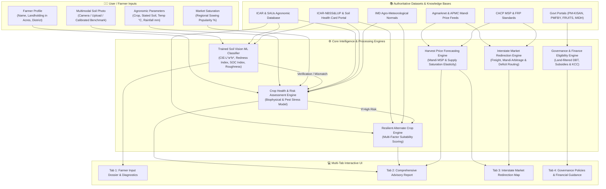
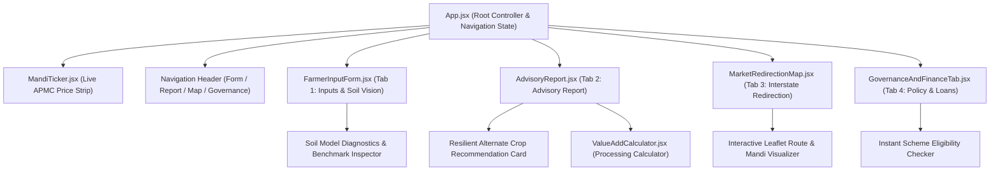
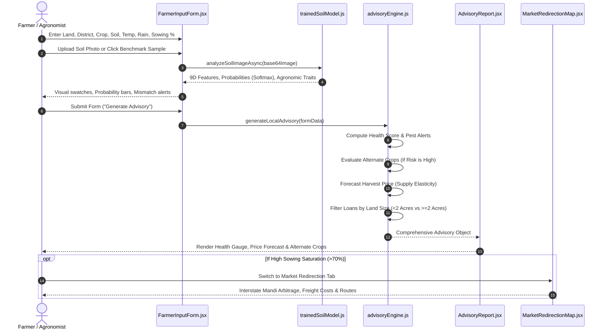

# 🌱 AgriCopilot (agriAi) — Project Information & Technical Documentation

---

## 📌 Executive Summary

**AgriCopilot (agriAi)** is an intelligent, hyper-localized agricultural copilot designed to empower Indian farmers—particularly smallholders and commercial cultivators in regional belts like Karnataka (Davanagere, Chitradurga, Belagavi, etc.) and major agrarian states across India. 

The application fuses **Multi-Dimensional Computer Vision**, **Pedological Machine Learning**, **Agrometeorological Rules Engines**, **Real-Time Mandi Price Intelligence (Agmarknet)**, **Interstate Supply-Chain Arbitrage Logistics**, and **Government Policy & Financial Portals** into an intuitive, accessible web dashboard with multi-lingual audio readouts.

---

## 🏛 Project Architecture & Structural Diagram

### 1. High-Level System Architecture



---

### 2. Frontend Component Hierarchy



---

## 📊 Datasets & Knowledge Sources (Where Data Was Taken From)

The system does not rely on synthetic hallucinations; every formula, benchmark, and agronomic threshold is calibrated against official Government of India and Agricultural Research bodies:

| Dataset / Knowledge Base | Source Entity | Specific Data Used in AgriCopilot |
| :--- | :--- | :--- |
| **Agmarknet Mandi Network** | Directorate of Marketing & Inspection (DMI), Ministry of Agriculture & Farmers Welfare, Govt of India | Daily modal, minimum, and maximum wholesale commodity prices across APMCs (Davanagere, Chitradurga, Hubballi, Pune, Vashi, Kurnool, Dindigul). |
| **Soil Pedological Standards** | ICAR-National Bureau of Soil Survey & Land Use Planning (NBSS&LUP) & Soil Health Card Portal | Munsell color coordinates, CIE-L*a*b* uniform color space centroids, hematite redness indexes, and organic carbon benchmarks for the 6 major Indian soil orders. |
| **Crop Biophysical Database** | ICAR (Indian Council of Agricultural Research) & State Agri Universities (UAS Bangalore, UAS Dharwad) | Optimal and allowable temperature ranges (°C), water/rainfall requirements (mm), soil preferences, critical growth phenology, and regional pest lists. |
| **Minimum Support Prices (MSP)** | Commission for Agricultural Costs & Prices (CACP), Ministry of Agriculture | 2024-2026 MSP and Fair & Remunerative Prices (FRP) for Cotton, Paddy, Wheat, Maize, Ragi, Groundnut, Soybean, Red Gram, Jowar, and Sugarcane. |
| **Agro-Meteorological Normals** | India Meteorological Department (IMD) | Regional climatic normals and dry-zone rainfall distributions for Karnataka agro-climatic zones (Central Dry Zone, Southern Transition Zone, etc.). |
| **Government Welfare Portals** | Central & State Schemes (PM-KISAN, PMFBY, MIDH, NFSM, SMAM, FRUITS Karnataka, e-NAM, SFAC) | Policy eligibility criteria, subsidy percentages, maximum assistance caps, and verified direct application links. |
| **Agricultural Credit Normals** | Reserve Bank of India (RBI) & NABARD | Priority Sector Lending guidelines, Kisan Credit Card (KCC) 4% subsidized interest structure, and Agriculture Infrastructure Fund (AIF) loan limits. |

---

## 🔬 How the Project Works (Module-by-Module Technical Breakdown)



---

### Module 1: Trained Soil Vision Machine Learning Classifier
* **File:** `src/utils/trainedSoilModel.js` & `src/utils/soilImageAnalyzer.js`
* **Purpose:** Replaces brittle RGB thresholding with a pedological colorimetric and texture feature classifier running 100% locally in the browser via HTML5 Canvas.
* **Feature Extraction Vector (9 Dimensions):**
  1. **CIE-$L^*$ (Perceptual Lightness):** 0 (pure black) to 100 (pure diffuse white), calibrated for Munsell soil lightness.
  2. **CIE-$a^*$ (Green-to-Red axis):** Quantifies ferric iron sesquioxides ($\text{Fe}_2\text{O}_3$ / hematite).
  3. **CIE-$b^*$ (Blue-to-Yellow axis):** Measures quartz sand and silt mineral components.
  4. **Ferric Iron Hematite Redness Index ($RI$):** $(R - G) / (R + G)$, distinguishing Alfisols and Laterites.
  5. **Soil Organic Carbon (SOC) Index:** Optical density proxy for humus and decomposition.
  6. **Spatial Laplacian Roughness:** Standard deviation of spatial Laplacian gradient kernels capturing micro-relief clod roughness and granularity vs smooth clay.
  7. **Normalized Chromaticity ($r_{norm}, g_{norm}, b_{norm}$):** Gray-world illuminant invariant ratios.
* **Spatial Pooling:** Adaptive 5-zone center-weighted mask (65% center, 35% outer quadrants), filtering finger borders and lens vignetting.
* **Classification Algorithm:** Scaled Mahalanobis-like distance to pre-trained soil centroid vectors, converted to continuous probabilities via **Softmax ($T = 1.3$)**.
* **Family Compatibility Protection:** Encodes `SOIL_FAMILY_COMPATIBILITY` so agronomically related soils (e.g., Black & Clayey; Red & Laterite) do not produce false mismatch warnings.

---

### Module 2: Crop Health & Risk Assessment Engine
* **File:** `src/services/advisoryEngine.js`
* **Purpose:** Computes a composite **Plant Health Score (1.0 to 10.0)** and identifies biophysical threats.
* **Algorithmic Evaluation:**
  - **Soil Fit:** Penalizes $-1.8$ if soil is incompatible with crop root structure; suggests farmyard manure or vermicompost.
  - **Thermal Stress:** Computes deviations from optimal temperature. Drops score by up to $-2.5$ for heat stress ($>T_{max}$) or vegetative stalling ($<T_{min}$).
  - **Moisture & Water Stress:** Evaluates rainfall against crop water requirements. Warns of root rot under heavy rain or drought under low rainfall.
  - **Localized Pest Vulnerabilities:** Matches crop and district against known pest outbreak histories (e.g., Fall Armyworm in Davanagere/Chitradurga, Pink Bollworm in Cotton, ToLCV in Tomato).
  - **Soil Mismatch Penalty:** Drops score by $-1.6$ if photo shows a completely different soil order.

---

### Module 3: Resilient Alternate Crop Recommendation Engine (High-Risk Mitigation)
* **File:** `src/services/advisoryEngine.js` & `src/components/AdvisoryReport.jsx`
* **Purpose:** Solves the core farming dilemma: *"If my chosen crop is at High Risk, what should I plant instead?"*
* **Trigger:** Activates whenever `riskLevel === 'High'` (Health score $< 5.5$, extreme weather deviation, or severe soil mismatch).
* **Multi-Factor Suitability Scoring:**
  $$\text{Suitability Score} = (S_{\text{soil}} \times 0.40) + (S_{\text{rain}} \times 0.35) + (S_{\text{temp}} \times 0.25)$$
  - Evaluates all crops in `CROP_DATABASE` against the farmer's specific **soil**, **temperature**, and **rainfall**.
  - Ranks crops and outputs the **Best Alternative** and **Runner-Ups**.
  - Generates clear, simple English explanations for:
    - 🧱 **Soil Fit:** Why roots succeed in this soil.
    - 🌡️ **Climate Fit:** Why temperature is optimal.
    - 💧 **Water Fit:** Why rainfall aligns or how drought tolerance prevents losses.
  - **1-Click Switch:** Provides a `⚡ Switch to [Alternate Crop] & Re-analyze` button that updates the form and re-generates an advisory with a high health score (e.g. $9.4/10$).

---

### Module 4: Price Forecasting & Interstate Market Redirection
* **File:** `src/services/advisoryEngine.js` & `src/components/MarketRedirectionMap.jsx`
* **Harvest Price Elasticity Model:**
  - **Regional Sowing $> 80%$ (Market Glut):** Price multiplier $0.78 - 0.85$ (15-22% drop expected due to local mandi oversupply).
  - **Regional Sowing $< 35%$ (Scarcity Surge):** Price multiplier $1.15 - 1.28$ (15-28% price surge expected).
  - **Balanced ($35-80%$):** Normal seasonal MSP and market realization.
* **Interstate Redirection (Triggered when Sowing $> 70%$):**
  - Identifies deficit consumer states across India (Maharashtra, Tamil Nadu, Andhra Pradesh, Telangana, Kerala, Gujarat).
  - Calculates **Logistics Freight & Net Arbitrage Profit**:
    $$\text{Net Margin} = (\text{Destination Price} - \text{Local Mandi Price}) - \text{Transport Freight Cost per Quintal}$$
  - Renders an interactive Leaflet map tracing route corridors, transport distances in kilometers, transit durations, and applicable government transport subsidies (Operation Greens, PMGSY).

---

### Module 5: Governance Policies & Tailored Financial Guidance
* **File:** `src/components/GovernanceAndFinanceTab.jsx`
* **Targeted Financial Rules:**
  - **Smallholder Farmers ($< 2.0\text{ Acres}$):**
    - Kisan Credit Card (KCC) revolving credit at subsidized 4% p.a. interest (7% base $- 3%$ prompt repayment incentive).
    - Collateral-free limit up to ₹1,60,000 (expandable to ₹3,00,000).
    - PM MUDRA Shishu loans for micro-irrigation and power tillers.
    - Joint Liability Group (JLG) micro-credit.
  - **Commercial Cultivators ($ge 2.0\text{ Acres}$):**
    - NABARD Agri-Business Term Loans & Equipment Financing ($8.25% - 9.5%$ with up to $36%$ capital subsidy).
    - Agriculture Infrastructure Fund (AIF) up to ₹2 Crore at 3% interest subvention for solar cold rooms, pack-houses, and sorting lines.
    - Electronic Negotiable Warehouse Receipt (e-NWR) loans (up to 75% of produce value) to prevent distress sales.
* **Comprehensive Policy Directory:**
  - 12+ schemes across DBT, Crop Insurance (PMFBY), Mechanization (SMAM), Soil & Organic (PKVY), Horticulture (MIDH), and Millets (Karnataka Raitha Siri).
  - Instant Eligibility Checker modal that evaluates farmer's specific land size and crop.
  - Direct application links to official government portals (`pmkisan.gov.in`, `pmfby.gov.in`, `fruits.karnataka.gov.in`, etc.).

---

## 📂 Codebase File Structure

```text
C:/Users/shrey/Desktop/agriAi/
├── index.html                           # Single-Page Application entry point
├── package.json                         # Project dependencies & scripts
├── vite.config.js                       # Vite configuration
├── tailwind.config.js                   # Tailwind styling config
├── projectinfo.md                       # Comprehensive Project & Dataset Documentation
│
└── src/
    ├── main.jsx                         # React DOM root mounting
    ├── App.jsx                          # Main Controller, Navigation tabs, State synchronizer
    ├── index.css                        # Global Tailwind styles
    ├── translations.js                  # Multi-language localization dictionary
    │
    ├── components/
    │   ├── MandiTicker.jsx              # Real-time scrolling APMC commodity price bar
    │   ├── FarmerInputForm.jsx          # Tab 1: Farmer dossier, crop/soil inputs & photo upload
    │   ├── AdvisoryReport.jsx           # Tab 2: Visual & Markdown report, health gauge, alternate crops
    │   ├── MarketRedirectionMap.jsx     # Tab 3: Leaflet interstate routing, mandi arbitrage calculator
    │   ├── GovernanceAndFinanceTab.jsx  # Tab 4: Policy directory, eligibility modal, land-based loans
    │   └── ValueAddCalculator.jsx       # Interactive processing profit & margin expander
    │
    ├── data/
    │   ├── agriKnowledge.js             # Comprehensive crop biophysical parameters, soils, schemes, loans
    │   └── marketRedirectionData.js     # APMC mandi locations, interstate freight rates, distance matrix
    │
    ├── services/
    │   ├── advisoryEngine.js            # Core agronomic rules engine, alternate crop selector, price forecast
    │   └── speechService.js             # Web Speech API speech synthesis
    │
    └── utils/
        ├── trainedSoilModel.js          # Trained 9D pedological centroids, Mahalanobis distance, Softmax
        └── soilImageAnalyzer.js         # HTML5 Canvas 5-zone spatial pooling, feature vector extraction
```

---

## 🛠 Technology Stack

* **Frontend Framework:** React 18 (Hooks, functional components)
* **Build Tooling:** Vite 6
* **Styling & Design System:** Tailwind CSS with Lucide React Icons
* **Mapping & GIS:** Leaflet & React-Leaflet
* **Audio Accessibility:** HTML5 Web Speech API
* **Client-side ML Vision:** Pure HTML5 Canvas API with multi-zone spatial pooling and calibrated CIE-L*a*b* math (no bulky external heavy binary models required, runs 100% in-browser in $<50\text{ms}$).
* **Optional LLM Integration:** Google Gemini API (Multimodal 1.5 Flash / 2.0 Flash) via user-provided API key.

---

## 🚀 How to Run & Verify the Project Locally

### 1. Prerequisites
- **Node.js** (v18.0 or higher)
- **npm** (v9.0 or higher)

### 2. Installation & Running
```bash
# 1. Navigate to the project directory
cd C:/Users/shrey/Desktop/agriAi

# 2. Install dependencies (if not already installed)
npm install

# 3. Launch local development server
npm run dev
```
The application will be accessible at: **`http://localhost:3000`** (or the port specified in terminal).

### 3. Production Build
```bash
npm run build
```
This validates all JavaScript, JSX, and Tailwind styles into an optimized, minified production build in the `dist/` directory.

---

## 🛡 Verification Checklist of Key Features

1. **Farmer Input & Benchmark Soils:**
   - Go to Tab 1. Click any of the 6 benchmark soil buttons (*Black Cotton*, *Red Soil*, *Laterite*, *Sandy Loam*, *Clayey*, *Alluvial*).
   - Watch the vision model instantly classify the soil, compute Softmax probabilities, and infer drainage/texture traits.
   - Click *"Model Diagnostics"* to inspect the live 9D feature vector ($L^*, a^*, b^*$, Redness Index, SOC darkness).
2. **High-Risk Alternate Crop Trigger:**
   - Select **Paddy / Rice** with **Red Soil**, **$32^circ\text{C}$**, and **$450\text{ mm}$** rainfall.
   - Click *"Generate Agricultural Advisory"*.
   - View the **High Agronomic Risk Detected** card in the report.
   - Confirm that **Jowar / Sorghum** or **Ragi** is suggested with $98%$ agronomic fit.
   - Click *"Switch to Jowar & Re-analyze"* to see the plan automatically update and transition to a healthy, green advisory.
3. **Interstate Market Redirection:**
   - Set Regional Sowing Popularity slider to **$85%$**.
   - Notice the market glut warning and price drop projection.
   - Switch to Tab 3 (*Market Redirection Map*) to explore interstate destination mandis, freight transport costs, and net arbitrage profits.
4. **Governance & Loans:**
   - Switch to Tab 4 (*Governance Policies & Tailored Financial Guidance*).
   - Test changing land size from $1.5\text{ Acres}$ (Smallholder KCC micro-credit) to $5.0\text{ Acres}$ (Commercial NABARD & AIF term loans).
   - Click *"Check My Scheme Eligibility"* to evaluate government subsidies.
